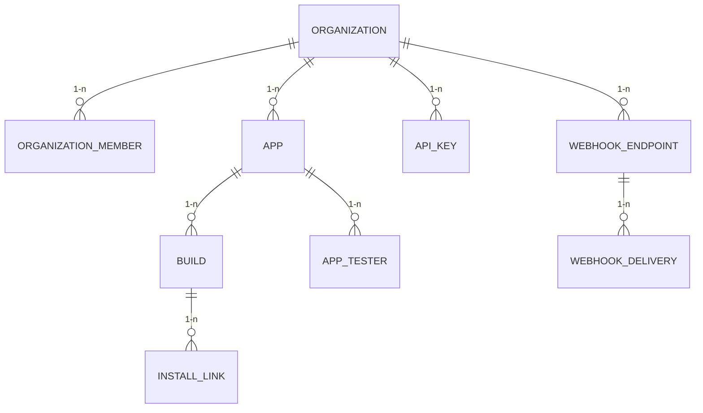

# ERD — Hangar (Project 2, Giai đoạn 2)

> Placeholder — vẽ chính thức ở Ngày 2 (Tuần 4) khi entity `Organization`/`OrganizationMember`/`App` đã có migration thật. Xem thiết kế entity đầy đủ (bảng field) ở [2-tai-lieu-nghiep-vu.md](2-tai-lieu-nghiep-vu.md) mục 2 — ERD ở đây chỉ là sơ đồ quan hệ, không lặp lại chi tiết field.

